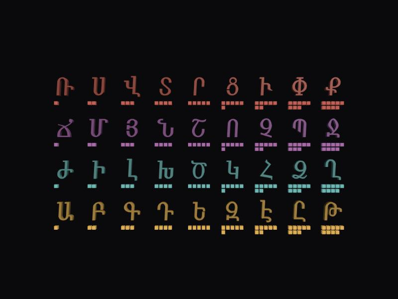

# Mashtots numeral lattice (X3D)

The 36 letters of Mesrop Mashtots's alphabet as real extruded geometry, laid out as the Armenian numeral system:
column = digit 1..9, row = decimal place (units at the bottom, then tens, hundreds, thousands). Under each letter, one cube per unit of its digit.
Static scene, no animation. Separate from `work/mashtots` (the textured reveal): nothing in that folder or in `mashtots-landing` was edited; only `vendor/x_ite` was copied from it.



## Run
```bash
cd ~/Projects/x3d/work/mashtots-numerals && python3 -m http.server 8801 --bind 127.0.0.1
```
Open http://127.0.0.1:8801/index.html (X_ITE, WebGL). Drag to orbit.

## Files
| file | what |
|---|---|
| `letters.py` / `letters.json` | 36 rows: index, char, code point, Unicode name, value, place, digit, row, col. Computed from `unicodedata` + arithmetic |
| `numerals.py` | encode/decode 1..9999, self-test |
| `glyph_contours.py` -> `contours.json` | Mshtakan (macOS system font) outlines flattened to polylines |
| `tessellate_blender.py` -> `tris.json` | triangulation with Blender's `tessellate_polygon` (headless; handles holes) |
| `build_scene.py` -> `mashtots-numeral-lattice.x3d` | caps + side walls, per-letter `MetadataSet` |

Rebuild: `python3 letters.py && python3 numerals.py && python3 glyph_contours.py && /Applications/Blender.app/Contents/MacOS/Blender -b --python tessellate_blender.py && python3 build_scene.py`

## Verified (run here)
- The first 36 of the 38 capitals in U+0531..U+0556 match the alphabet order used in `work/mashtots/reveal_data.py`; Օ and Ֆ (U+0555, U+0556) are excluded as the later additions.
- Values: 1..9, 10..90, 100..900, 1000..9000; all 36 distinct; sum 49,995 (= 45 x 1111).
- Every integer 1..9999 encodes to exactly one letter string and decodes back (9,999 unique strings). 36 = ԼԶ, 405 = ՆԵ, 9999 = ՔՋՂԹ.
- Tessellation: triangle area equals polygon area (holes subtracted) for all 36 glyphs, 2 % tolerance.
- Extrusion: signed mesh volume equals area x depth for all 36 (outward-facing walls). This checks orientation, not full watertightness.
- XSD valid; x3d_mcp semantic check 0 errors / 0 warnings; renders in X_ITE in the Claude built-in browser; the metadata is readable from the scene graph (`getNamedNode("L25_0549").metadata`).

## Not verified / caveats
- Only X_ITE in one browser was tried. No other viewer, no headset.
- Mshtakan's licence for redistributing its outlines is not checked; the geometry is derived from a macOS system font.
- The numeral convention is the standard additive one in descending order; no historical colophon was parsed. The Armenian Era offset (AD = AE + 551) is in `numerals.py` as an approximation and unused by the scene.
- Mashtots's 36 letters include Ւ (U+0552) as in the Unicode block; whether the original 34th sign was the digraph ու is a scholarly point I did not check.
- Flat 8-step curve flattening, so curved edges are slightly faceted (creaseAngle 0.7 hides most of it).

## Why it exists
Letters with machine-readable value turn a date in a colophon into a small expression a program can evaluate. This is the data layer for that idea, plus a scene a viewer can click into. The reveal's stone fills 4 columns x 9 rows in alphabet order (4 consecutive letters per row, from `reveal_data.py`); this lattice groups 9 consecutive letters per row, which is the decimal structure. If the stone were cut as 9 x 4 its rows would be units, tens, hundreds, thousands (a suggestion only; nothing there was changed).
