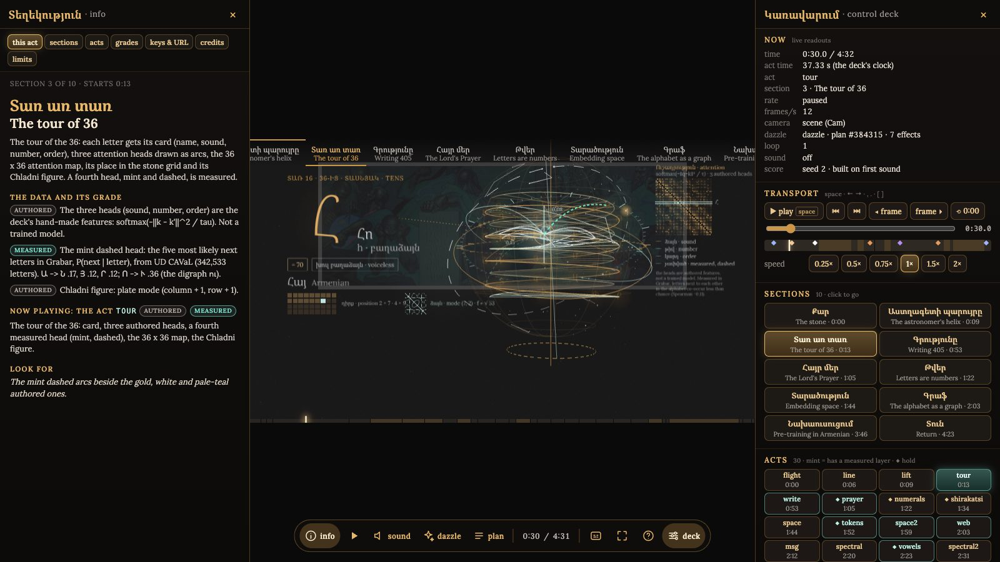

# Մաշտոց Համակարգ 2 · Mashtots System 2 · the slide show (standalone)

The Armenian alphabet (Mesrop Mashtots, c. 405 AD, 36 letters) read as a transformer, as one 272-second X3D piece: the letters leave a painted stone,
lift into an astronomer's helix, are toured one by one with their attention heads, write the first sentence and the Lord's Prayer, become numbers,
an embedding, a tokenizer's map, a graph (message passing, the Fiedler cut, PageRank, annealing, descent, a Markov walk, Fourier, Poincaré, SVD),
and close on pre-training in Armenian, then fall home. Every figure is graded (Measured, Established, Estimate, Conjecture, or Authored).
This is the **expanded measured cut**, with the dazzle conductor (seeded time effects), the live WebAudio score and the graded panels, plus the
**approved cut** and **slide 1** as further modes. Everything it needs is in this folder; it runs offline.



## Run it

```bash
./run.sh
```

Starts a local server on `http://127.0.0.1:8410` (Node 18+, no packages) and opens the show with the control deck. Other entries:
`./run.sh approved` (the approved cut), `./run.sh slide1`, `./run.sh score` (score lab), `./run.sh stop`. `PORT=8411 ./run.sh` for another port.
Without the script: `node serve.mjs` and open `http://127.0.0.1:8410/`.

Use a desktop browser with a real GPU, in a visible window (a hidden tab leaves the scene on "loading": the browser throttles it). Tested in Chromium on an Apple M3.
The scene compiles about sixty shaders: the first load takes a few seconds. Headphones recommended; the start card's first click also unlocks the audio.

## Every feature, on screen

Two panels, both docked beside the picture (the picture shrinks; nothing is covered), both reachable from the pill at the bottom:

- **deck** (`K`): readouts (time, the deck's own act time, act, section, rate, frames per second, camera, dazzle plan, loop, sound, score); transport
  (play, sections, frame steps, back to 0:00, a scrubber, a minimap of the 30 acts with this loop's effects, six speeds); 10 section and 30 act
  buttons; 4 cameras and orbit; dazzle level, plan seed (fix it or draw a new one), the plan as a clickable list, **15 moment replays on demand**;
  display (calm, captions, graded panels, title cards, hide controls, full screen, key help, start card); sound (the live score, tape effects and
  their level, five effect voices to fire by hand, score seed 0 to 2, six score layers, score version v2 / v2 unmixed / v1); scene (measured or
  expanded) and skin (pill, director's bar, none); a link to this exact moment; links to the approved cut, slide 1, slide 1 classic, the score lab,
  the effects lab, the director's page and the v1 score lab.
- **info** (`I`): *this act* (follows the piece: what the section shows, its data with grade chips, the act now playing and what to look for),
  *sections*, *acts* (both tables jump on click), *grades*, *keys & URL* (every key and URL option), *credits*, *limits*.

The approved cut and slide 1 get a button strip of their own (cut switcher, cameras, orbit, previous/next, cinema, full screen, an info card).
**[FEATURES.md](FEATURES.md)** lists every feature with its button, key and URL option and how it was checked: a script clicks every control
(`tools/feature-test.js`, 148 of 148 passed, console clean; `tools/feature-test-result.txt`).

New here (the pizzazz): a **title card** at each section change (the Armenian name in a gold sheen, its number, its grade chips); the 36 letters
**drifting like embers** behind the start card; a **glowing playhead** on the act bar; the minimap with the plan's effects as coloured diamonds.

## Architecture

```
serve.mjs                 zero-dependency static server (byte ranges, MIME types, 127.0.0.1, no way out of app/)
run.sh                    start + open; stop
app/stage.html            THE SHOW. The Landing's director page: owns the scene's time (writes the Seek TimeSensor's cycleInterval, ROUTEd to
                          every shader's toff, each frame), the start card, the pill, captions, the live score and the dazzle conductor.
                          Standalone changes: window.__stage widened into an API, a "stage:seg" event, score seed and layers, keys I and K,
                          X_ITE's UI font mapped to the local Lora, X_ITE 16's addFieldCallback.
app/deck.js, deck.css     NEW. The deck, the info panel, the title cards, the playhead, the start-card letters; drives only window.__stage.
app/info.js               NEW. What every section and act shows, its data and grade; keys, URL options, credits (from the Landing's READMEs).
app/conductor.js          the dazzle layer: seeded plans of dip, surge, freeze, echo, cut, replay, wobble; 15 moments (now exported)
app/fx.js                 the sound of time dilation (rate low-pass, tape-stop, rewind, riser, sink, tick); fx_measure.html measures it
app/measured.js/.json     the graded panels: authored beside measured
app/score/                the live score v2 (score.js, score_data.json, score_mix.json, loudness.js) and the score lab (index.html)
app/explore/retime/build-measured/   the scene: mashtots-landing-measured.x3d (3.98 MB, ~60 GLSL shaders), its sections, glyph atlases, the mural
app/explore/retime/build/            the expanded cut without the mint layers (?scene=expanded)
app/explore/retime/timelines.json    the real-time warps of the deck's act time (approved, graph-expanded, measured)
app/explore/director/     captions.json and the earlier director page;  app/explore/live-score/  the v1 score
app/explore/data-graph/out/          the measured Grabar graph (graph.json, insights) the mint layers were built from
app/index.html + mashtots-landing.x3d + sections.json + 7 mp3   the approved cut (204.25 s, mp3 score)
app/mashtots-reveal.x3d, -classic.x3d + glyphs/                 slide 1 (16.65 s) and its shader-free fallback
app/approved-controls.js  NEW. The button strip and info card for the approved cut and slide 1
app/vendor/x_ite/         X_ITE 16.5.1 (vendored)       app/fonts/   Lora, Noto Serif Armenian (OFL)
tools/feature-test.js     clicks every control and checks the state;  tools/run-feature-test.mjs  the same from Node (needs Playwright)
docs/shots/               screenshots of every screen
```

Sizes: `app/` 56 MB (the approved cut's seven mp3 scores are 34 MB of it).

## Provenance

- Copied on 2026-11-03 from `~/Projects/x3d/work/mashtots-demo-site-eval/integrated/shell/landing/` (a frozen local git repo, tag `freeze-2026-11-03`,
  commit `eaa7d37`), and slide 1's two scenes from `~/Projects/x3d/work/mashtots-slide1-FROZEN/`. Nothing in those folders was changed.
- The first commit of this repository is the **verbatim** copy; `git diff <first commit>` shows every change made for the standalone.
- Changed in copied files: `stage.html` (API, event, score options, keys, font, callback), `conductor.js` (`export` on three constants),
  `index.html` (one script tag, the font line), `explore/director/index.html` (font, callback), `fx_measure.html` (a favicon line),
  `mashtots-reveal-classic.x3d` (the `info` MFString quoted, which silenced an X_ITE parser warning). No scene content, number or timing changed.
- Fonts: Lora and Noto Serif Armenian were already in the copy (OFL). No download was needed for this project.
- The build history (the deck, the X3D port, the measured layers, the live score, their checks) is in the source folders' READMEs:
  `mashtots-landing/README.md`, `mashtots-demo-site-eval/integrated/README.md`, `QA.md`, `ROADMAP.md`.

## What was checked, and how

- **By measurement** (Chromium via Playwright, Apple M3, 2026-11-03): 148 of 148 control checks; six reload variants; every page of the project
  loaded with **0 console errors or warnings and 0 failed requests** (after fixing a PT Sans 404, a deprecated-API warning, an MFString warning and a
  missing favicon); 120 animation frames per second in the page and 60 X3D frames per second while playing with sound; AudioContext running at 48 kHz;
  the score builds 5,242 to 5,278 events per seed with 0 notes outside the harmony table.
- **By eye**: every screen in `docs/shots/` (start card, title card, docked panels, wild dazzle, a moment replay from the helix camera, the approved cut,
  its info card, slide 1, classic, the score and effects labs, the director's bar, a 390 x 844 phone).
- **Not checked**: **listening** (the builder cannot hear: the score, the tape effects and the mint sonification are measured, never heard); Safari,
  Firefox, other GPUs, real touch hardware, a screen reader; the built-in Claude browser pane while hidden (X_ITE pauses there).
- **Armenian**: the section names and the scene's text are the Landing's; the start card's "և սկսել" and the Lord's Prayer text are flagged
  for a native reader. The only new Armenian here is the two panel headings «Կառավարում» (control) and «Տեղեկություն» (information): also for a reader's check.

## Credits

Mural: Van Khachatur, the three-part staircase fresco of the Matenadaran, 1959-60 (photograph via Wikimedia Commons). Data: UD Classical Armenian
CAVaL (Grabar, CC BY-NC-SA), UD Armenian ArmTDP, the Tekken tokenizer (read locally). X_ITE 16.5.1 by create3000. Fonts: Lora, Noto Serif Armenian
(SIL OFL). The deck "Mashtots System 2"; the X3D port, the measured layers, the conductor, the live score and this standalone were built with Claude.
